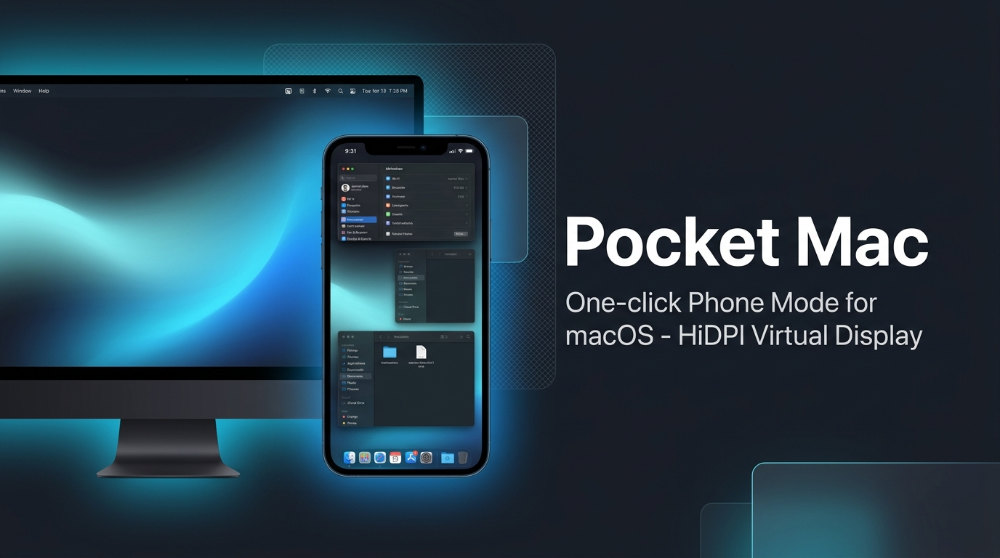
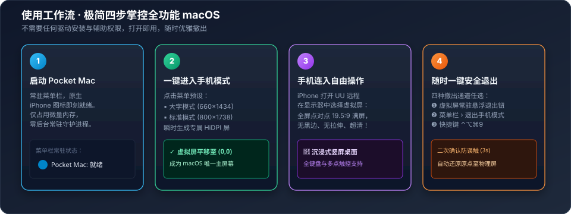
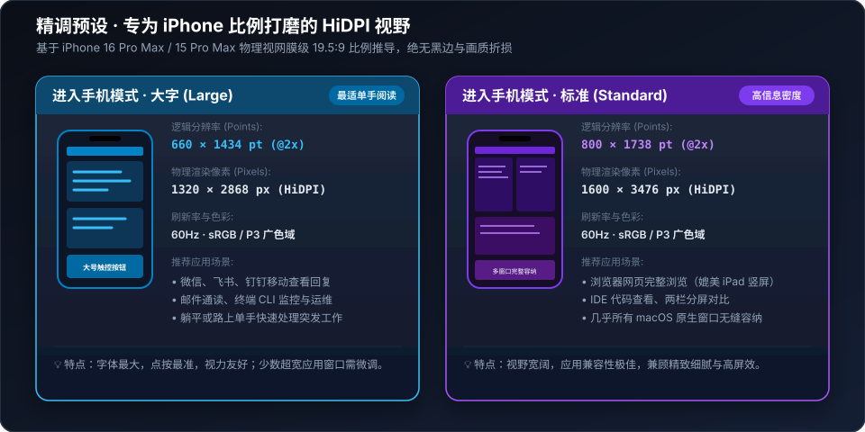
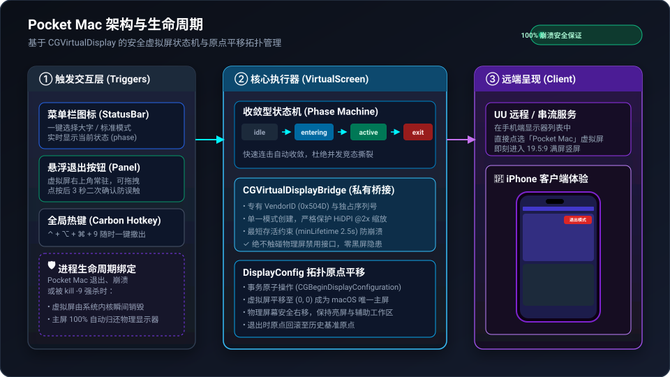
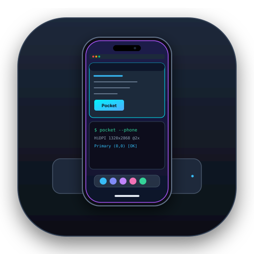

<div align="center">



# 📱 Pocket Mac

**一键在 Mac 上开启「手机模式」 · 为 iPhone 量身打造的 HiDPI 竖屏虚拟显示器**

[-000000?style=for-the-badge&logo=apple&logoColor=white)](https://apple.com)
[](https://swift.org)
[](LICENSE)
[-10B981?style=for-the-badge)](#-核心特性与安全保证)
[](#-快速开始)
[](CONTRIBUTING.md)

<p align="center">
  <a href="#-为什么需要-pocket-mac">项目背景</a> •
  <a href="#-工作流程">工作流程</a> •
  <a href="#-两档-hidpi-精调预设">预设规格</a> •
  <a href="#-系统架构与安全机制">架构安全</a> •
  <a href="#-快速开始">快速开始</a> •
  <a href="#-横向方案对比">方案对比</a> •
  <a href="#-调试与自检">调试工具</a> •
  <a href="CHANGELOG.md">更新日志</a>
</p>

</div>

---

## 💡 为什么需要 Pocket Mac？

日常外出或离座时，我们常常需要用 iPhone 远程连接 Mac 处理突发工作（如查看代码、执行脚本、审批流程或回复邮件）。但在手机上操作 macOS 常常面临两个极大痛点：

1. **画面比例错位与黑边**：手机屏幕是竖屏 19.5:9，而 Mac 物理屏幕是横屏 16:9 或 16:10。远程显示时不仅上下有巨大黑边，内容缩放到手机上更是字体小如蚂蚁，难以辨认与触控。
2. **硬件诱骗器与现有方案痛点**：
   - **硬件 HDMI 诱骗插头 (Dummy Plug)**：无法随身携带，且通常只支持标准横屏 1080P/4K，无法精准匹配 iPhone 视网膜点对点竖屏。
   - **第三方重型工具**：依赖复杂的系统辅助权限、内核驱动或频繁修改物理屏，甚至在崩溃时导致物理显示器全黑无法复原。

**Pocket Mac 彻底解决了这些问题**：只需在菜单栏轻点一下，即可在 macOS 中瞬时建立一块专为 iPhone 比例打磨的 HiDPI 视网膜虚拟竖屏，并将主屏自动切入该屏；手机端打开 UU 远程（或任何远程工具）即可享受如同原生手机 App 般的沉浸式竖屏 macOS 桌面！

---

## ✨ 核心特性与安全保证

- 🚀 **极简一键直达**：原生菜单栏常驻图标，秒级进入/退出，支持全局快捷键 `⌃ control + ⌥ option + ⌘ command + 9`。
- 🛡️ **绝对安全 · 零黑屏风险**：**绝不禁用物理屏幕**。虚拟屏生命周期与进程严格绑定，若 App 退出、崩溃或被 `kill -9` 强杀，系统内核立即回收虚拟屏，主屏毫秒级回弹至物理显示器。
- 🔒 **零权限 & 纯本地**：不需 Accessibility（辅助功能）、不需 Screen Recording（屏幕录制）、不需 Root/Sudo 提权，不发起任何网络请求，纯本地隐私守护。
- 📱 **专为移动端调优的双档 HiDPI 预设**：专为 iPhone 16 / 15 系列等现代视网膜屏幕精准计算缩放比例，告别毛刺与变形。
- 🪟 **悬浮防迷航退出按钮**：虚拟屏右上角常驻可拖拽「退出手机模式」悬浮窗，内置 3 秒二次点击防误触，单手即可轻松撤出。
- ⚡ **轻量零外部依赖**：基于原生 Swift + CoreGraphics 私有桥接，打包体积极小，构建仅需 0.2 秒。

---

## 🔄 工作流程

<div align="center">
  
</div>

```
[Mac 菜单栏] ──(点击进入手机模式)──> [创建 HiDPI 竖屏] ──(自动移至原点 0,0)──> [成为 macOS 主屏幕]
                                                                                │
[安全退出 / 异常退出] <───(主屏毫秒级回滚原点) <─── [UU 远程 iPhone 端满屏操控] <──────┘
```

1. **点击启动**：从菜单栏图标中选择「大字模式」或「标准模式」。
2. **瞬时就绪**：macOS 自动将该虚拟竖屏平移至 `(0, 0)` 设为主屏幕，外接物理屏安全右移作为扩展。
3. **手机连入**：在 iPhone 打开 UU 远程 App，在被控端屏幕列表中选择「Pocket Mac」虚拟屏，即刻享受全屏竖屏操作。
4. **随时撤出**：在手机上点击屏幕右上角的红色浮窗按钮（或菜单栏/快捷键），虚拟屏释放，所有显示拓扑完好还原。

---

## 📐 两档 HiDPI 精调预设

<div align="center">
  
</div>

| 预设模式 | 逻辑尺寸 (Points) | 渲染物理像素 (HiDPI @2x) | 屏幕长宽比 | 视觉体验与特点 | 推荐使用场景 |
|---|---|---|---|---|---|
| **大字模式 (Large)** | `660 × 1434 pt` | `1320 × 2868 px` | ~19.5:9 | **字体与按钮最大**，高可读性，单手触控极准 | 微信/飞书/邮件沟通、终端 CLI 监控与轻量运维、通勤路上快速操作 |
| **标准模式 (Standard)** | `800 × 1738 pt` | `1600 × 3476 px` | ~19.5:9 | **工作台级信息密度**，媲美 iPad 竖屏视野 | 浏览器完整网页排版、多窗口并列与文档比对、复杂桌面排版 |

---

## 🏛️ 系统架构与安全机制

> [!NOTE]
> 深入的技术调研、与上游方案的横向代码级对比及完整执行计划，请参阅：[PocketMac-技术评估与执行计划.md](PocketMac-技术评估与执行计划.md)。

<div align="center">
  
</div>

### 1. 目标状态收敛型状态机 (`VirtualScreen.swift`)
Pocket Mac 状态机采用单向目标收敛模型：
```
[ idle ] ──(enter)──> [ entering ] ──(stable)──> [ active ] ──(exit)──> [ exiting ] ──> [ idle ]
```
- **连击防抖**：用户快速连击菜单或浮窗不会导致创建与销毁交织发生，执行器按步骤单步推进。
- **保护模式**：若系统 WindowServer 报告事务冲突，自动安全熔断并进入受控保护模式。

### 2. 进程绑定与零残留销毁
- 虚拟显示器（Vendor ID `0x504D`）由私有 `CGVirtualDisplay` 接口创建，并设有 `minLifetime = 2.5s` 最短生命周期限制以避免触发 WindowServer 竞态崩溃。
- **无需看门狗进程**：因为 Pocket Mac 从不调用 `CGSConfigureDisplayEnabled` 禁用物理显示器，因此根本不存在物理屏全黑无法恢复的险情。只要进程结束，macOS 就会自动卸载虚拟屏，物理屏自动归位。

---

## 📊 横向方案对比

| 对比维度 | 🔌 硬件 HDMI 诱骗插头 | 🛠️ 重型虚拟屏工具 | 📱 **Pocket Mac** |
|---|---|---|---|
| **iPhone 专属比例** | ❌ 仅限常见横屏 (16:9) | ⚠️ 需手动配置复杂参数 | ✅ **开箱即用 19.5:9 满屏无黑边** |
| **物理屏安全性** | ❌ 物理拔插容易松动失联 | ⚠️ 禁用物理屏可能导致黑屏死锁 | ✅ **绝不禁用物理屏，零黑屏隐患** |
| **异常恢复机制** | ❌ 硬件持续常驻，无法自动复原 | ⚠️ 依赖后台守护看门狗 | ✅ **进程内核级绑定，秒级安全还原** |
| **系统权限要求** | 不需要 | ❌ 需辅助功能、屏幕录制等高危权限 | ✅ **完全零权限，纯本地离线** |
| **内存与资源占用** | 无软件界面 | ❌ 往往占用上百 MB 内存与后台守护 | ✅ **单二进制运行，极速启动** |
| **退出便捷度** | 需物理拔掉插头 | 需在手机微小菜单里艰难点击 | ✅ **常驻可拖拽悬浮防误触退出按钮** |

---

## 🚀 快速开始

### 系统要求
- macOS 14.0 (Sonoma) 或 macOS 15+ (Sequoia)
- 芯片：Apple Silicon (M1/M2/M3/M4 系列) 或 Intel Mac

### 方式一：从源码一键构建并安装（推荐）

```bash
# 1. 克隆代码仓库
git clone https://github.com/Handsomemikezzz/uuremote-pocket.git
cd uuremote-pocket

# 2. 一键编译并安装到 /Applications
scripts/build-app.sh --install
```

### 方式二：手动编译开发版

```bash
swift build -c release
.build/release/PocketMac
```

---

## 🎮 使用与退出指南

启动后，Pocket Mac 将常驻于屏幕顶部的 macOS 系统菜单栏：

<div align="center">
  
</div>

### 退出手机模式的 4 种安全方式（任何一种均可）：
1. 🔴 **屏幕悬浮按钮**：虚拟屏右上角常驻红色「退出手机模式」悬浮胶囊，点击一次后需在 3 秒内再次点击确认（防误触设计），且可在屏幕上自由拖拽。
2. 📱 **系统菜单栏**：点击菜单栏 iPhone 图标 › 点击「退出手机模式」。
3. ⌨️ **全局快捷键**：按下 `⌃ control + ⌥ option + ⌘ command + 9` 瞬间撤出。
4. 🛑 **直接退出应用**：在菜单栏选择「退出 Pocket Mac」或在终端 `killall PocketMac`，虚拟屏由系统底层立即销毁，主屏无缝回归物理屏。

> [!NOTE]
> 运行日志存放于 `~/Library/Logs/PocketMac.log`，可在菜单栏随时选择「打开日志」快速排查问题。

---

## 🧪 调试与自检

Pocket Mac 内置了完备的自动化质量验证工具：

```bash
# 1. 全功能自检模式：在真实环境下依次进入/退出大字与标准模式并做原点校验（耗时约 20 秒）
.build/debug/PocketMac --selftest

# 2. 高频压力测试：随机进入、快速切换、频繁退出压测 40 轮
.build/debug/PocketMac --stress 40

# 3. 进程异常退出恢复测试：进入大字模式并在 5 秒后退出，可配合 kill -9 测试内核回收能力
.build/debug/PocketMac --enter large --exit-after 5

# 4. 独立显示器探测工具：查看当前系统所有在线显示器、ID、分辨率与原点坐标
.build/debug/vdprobe --list
```

---

## 🗺️ 路线图 (Roadmap)

- [x] 基于 `CGVirtualDisplay` 的 HiDPI 竖屏创建与安全拓扑
- [x] 大字与标准双档 iPhone 专属预设
- [x] 右上角可拖拽防误触悬浮退出按钮
- [x] 全局紧急撤出快捷键 (`⌃⌥⌘9`)
- [x] 自动化自检与混沌压力测试套件
- [ ] 支持更多主流机型（iPad Pro / 折叠屏 / 常见 Android 旗舰分辨率）自定义配置
- [ ] 随登录自动启动（基于 `SMAppService`）开关
- [ ] 智能感应 UU 客户端断开连接后自动延时还原模式

---

## 🤝 参与贡献

欢迎对 Pocket Mac 进行代码改进或提交建议！在提交代码前，请参阅 [CONTRIBUTING.md](CONTRIBUTING.md)。

- 发现 Bug？欢迎提交 [Issue 报告](https://github.com/Handsomemikezzz/uuremote-pocket/issues/new?template=bug_report.md)
- 想要适配新分辨率或新特性？欢迎提交 [功能建议](https://github.com/Handsomemikezzz/uuremote-pocket/issues/new?template=feature_request.md)

---

## 📄 开源许可证与致谢

- 本项目基于 **[MIT License](LICENSE)** 开源。
- **致谢与渊源**：
  - 显示拓扑核心代码借鉴并深度重构自 [UUyc companion](https://github.com/aoyamashou/UUyc-companion)（作者 @aoyamashou，采用 MIT 开源协议）。
  - 感谢社区在 macOS `CGVirtualDisplay` 私有显示器接口探索上的开创性研究。
